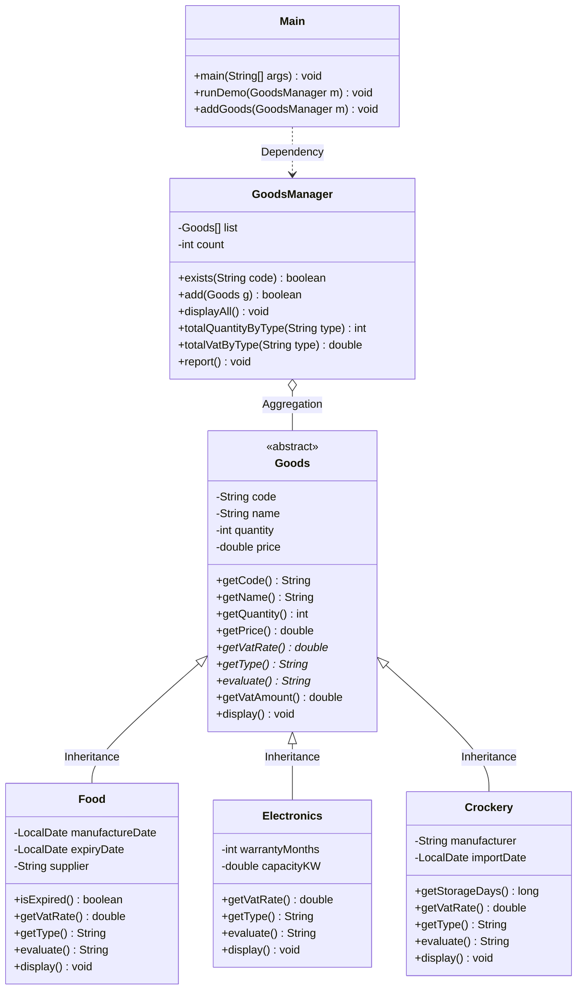

# Tài liệu thiết kế hệ thống Quản lý kho hàng siêu thị (Supermarket Inventory) - Practice 2

## 1. Mục tiêu và Phạm vi
Hệ thống quản lý kho hàng siêu thị gồm 3 loại hàng hóa:
- **Thực phẩm (`Food`)**
- **Điện máy (`Electronics`)**
- **Gốm sứ (`Crockery`)**

Cung cấp các chức năng:
- Đánh giá mức độ tiêu thụ (consumption evaluation).
- Quản lý danh sách hàng hóa bằng mảng (`Goods[]`), chống trùng mã hàng.
- Báo cáo tổng số lượng tồn kho và tiền thuế VAT theo từng loại hàng.

---

## 2. Các giả định đã chốt (Assumptions)
1. **"Considered to be sold"** của điện máy được hiểu là **"Easy to sell"** (hàng bán chạy, tồn kho ít).
2. **"Expired"** nghĩa là `ngày hết hạn < ngày hiện tại` (`LocalDate.now()`).
3. **Thời gian lưu kho (gốm sứ)** = số ngày từ `ngày nhập` đến hôm nay (`ChronoUnit.DAYS.between(importDate, LocalDate.now())`).
4. **Tiền VAT của một mặt hàng** = `đơn giá × số lượng × thuế suất`. **VAT của một loại** = tổng VAT các mặt hàng thuộc loại đó.
5. Đơn giá phải `>= 0`. Số lượng `>= 0`. Mã hàng không được để trống hoặc rỗng.
6. Sử dụng mảng thuần `Goods[]` có sức chứa tự mở rộng (`Arrays.copyOf`) khi đầy. Không dùng `ArrayList` cho danh sách chính.
7. Ngày tháng theo định dạng chuẩn ISO: `yyyy-MM-dd`.

---

## 3. Danh sách lớp (Class List)

| Tên lớp | Loại (Type) | Mục đích |
|---|---|---|
| `Goods` | **abstract** | Lớp cha trừu tượng chung cho mọi hàng hóa trong kho |
| `Food` | **concrete** (`extends Goods`) | Quản lý mặt hàng thực phẩm |
| `Electronics` | **concrete** (`extends Goods`) | Quản lý mặt hàng điện máy |
| `Crockery` | **concrete** (`extends Goods`) | Quản lý mặt hàng đồ gốm sứ |
| `GoodsManager` | **concrete** | Quản lý danh sách hàng hóa lưu bằng mảng `Goods[]` |
| `Main` | **concrete** | Giao diện tương tác console menu và chế độ chạy tự động `--demo` |

---

## 4. Thuộc tính và phương thức từng lớp

### Class: `Goods` (abstract)
Attributes:
- `private final String code`: Mã hàng (duy nhất, không rỗng)
- `private final String name`: Tên hàng
- `private final int quantity`: Số lượng tồn kho ($\ge 0$)
- `private final double price`: Đơn giá ($\ge 0$)

Methods:
- `+ Goods(code: String, name: String, quantity: int, price: double)`: Constructor kiểm tra tính hợp lệ
- `+ getCode(): String`
- `+ getName(): String`
- `+ getQuantity(): int`
- `+ getPrice(): double`
- `+ abstract getVatRate(): double`: Trả về thuế suất VAT (0.05 hoặc 0.10)
- `+ abstract getType(): String`: Tên loại hàng ("Food" | "Electronics" | "Crockery")
- `+ abstract evaluate(): String`: Đánh giá mức độ tiêu thụ theo Requirement 2
- `+ getVatAmount(): double`: Tính tiền VAT = `price * quantity * getVatRate()`
- `+ display(): void`: In thông tin cơ bản

### Class: `Food` (concrete) extends `Goods`
Attributes:
- `private final LocalDate manufactureDate`: Ngày sản xuất
- `private final LocalDate expiryDate`: Ngày hết hạn ($\ge$ ngày sản xuất)
- `private final String supplier`: Nhà cung cấp

Methods:
- `+ Food(...)`: Gọi `super(...)` và kiểm tra ràng buộc `expiryDate >= manufactureDate`
- `+ isExpired(): boolean`: Kiểm tra hết hạn (`expiryDate.isBefore(LocalDate.now())`)
- `+ getVatRate(): double` (@Override): 0.05 (5%)
- `+ getType(): String` (@Override): "Food"
- `+ evaluate(): String` (@Override): Nếu tồn kho > 0 và hết hạn -> "Hard to sell"; ngược lại -> "Not evaluated"
- `+ display(): void` (@Override): In thông tin kèm ngày sản xuất, ngày hết hạn, nhà cung cấp

### Class: `Electronics` (concrete) extends `Goods`
Attributes:
- `private final int warrantyMonths`: Thời gian bảo hành (tháng, $\ge 0$)
- `private final double capacityKW`: Công suất (KW, $\ge 0$)

Methods:
- `+ Electronics(...)`: Gọi `super(...)` và kiểm tra ràng buộc `warrantyMonths >= 0`, `capacityKW >= 0`
- `+ getVatRate(): double` (@Override): 0.10 (10%)
- `+ getType(): String` (@Override): "Electronics"
- `+ evaluate(): String` (@Override): Nếu tồn kho < 3 -> "Easy to sell"; ngược lại -> "Not evaluated"
- `+ display(): void` (@Override): In thông tin kèm bảo hành và công suất

### Class: `Crockery` (concrete) extends `Goods`
Attributes:
- `private final String manufacturer`: Nhà sản xuất
- `private final LocalDate importDate`: Ngày nhập kho

Methods:
- `+ Crockery(...)`: Gọi `super(...)`
- `+ getStorageDays(): long`: Tính số ngày lưu kho từ `importDate` đến hiện tại
- `+ getVatRate(): double` (@Override): 0.10 (10%)
- `+ getType(): String` (@Override): "Crockery"
- `+ evaluate(): String` (@Override): Nếu tồn kho > 50 và lưu kho > 10 ngày -> "Slow sale"; ngược lại -> "Not evaluated"
- `+ display(): void` (@Override): In thông tin kèm nhà sản xuất, ngày nhập và số ngày lưu kho

### Class: `GoodsManager` (concrete)
Attributes:
- `private Goods[] list`: Mảng lưu danh sách hàng hóa (khởi tạo kích thước 10)
- `private int count`: Số lượng hàng hóa hiện có

Methods:
- `+ exists(code: String): boolean`: Kiểm tra xem mã hàng đã tồn tại hay chưa
- `+ add(g: Goods): boolean`: Thêm hàng hóa vào mảng, tự giãn mảng khi đầy, trả về `false` nếu trùng mã hoặc `null`
- `+ displayAll(): void`: Hiển thị tất cả hàng hóa kèm đánh giá tiêu thụ
- `+ totalQuantityByType(type: String): int`: Tính tổng tồn kho theo loại hàng
- `+ totalVatByType(type: String): double`: Tính tổng tiền VAT theo loại hàng
- `+ report(): void`: Báo cáo tồn kho và tiền VAT của cả 3 loại hàng

### Class: `Main` (concrete)
- Menu console tương tác người dùng (Thêm hàng, hiển thị danh sách, xem báo cáo, thoát).
- Phương thức `runDemo(GoodsManager m)` khi chạy với tham số `--demo` để kiểm thử tự động.

---

## 5. Quan hệ giữa các lớp

1. **Kế thừa (Inheritance - is-a):**
   - `Food is-a Goods`
   - `Electronics is-a Goods`
   - `Crockery is-a Goods`
   Mỗi lớp con kế thừa toàn bộ thuộc tính chung (`code`, `name`, `quantity`, `price`) và các phương thức thông qua `super(...)`.

2. **Chứa (Aggregation / Has-a):**
   - `GoodsManager has-a Goods[]`: Quản lý danh sách hàng hóa thông qua mảng đối tượng `Goods`.

3. **Đa hình (Polymorphism):**
   - Các phương thức `getVatRate()`, `getType()`, `evaluate()`, `display()` được khai báo trừu tượng tại `Goods` và cài đặt riêng biệt (`@Override`) tại từng lớp con `Food`, `Electronics`, `Crockery`.
   - `GoodsManager` xử lý danh sách đối tượng kiểu `Goods` nhưng khi gọi `list[i].evaluate()` hoặc `list[i].getVatAmount()`, cơ chế Dynamic Binding (Dynamic Method Dispatch) của Java sẽ tự động gọi phương thức tương ứng của kiểu đối tượng thực tế thời điểm runtime.

---

## 6. Sơ đồ lớp (UML Class Diagram)

