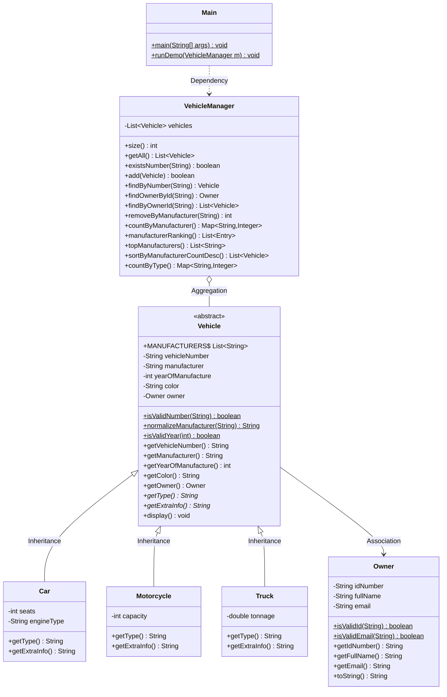

# Tài liệu thiết kế hệ thống Quản lý phương tiện giao thông (Police Vehicle Management) - Practice 3

## 1. Mục tiêu và Phạm vi
Hệ thống quản lý phương tiện giao thông phục vụ công an quản lý 3 loại phương tiện:
- **Ô tô (`Car`)**
- **Xe máy (`Motorcycle`)**
- **Xe tải (`Truck`)**

Cùng thông tin **Chủ xe (`Owner`)** và 7 chức năng nghiệp vụ cốt lõi:
1. Thêm phương tiện (ràng buộc biển số duy nhất, hãng hợp lệ, năm sản xuất, CMND, email).
2. Tìm phương tiện theo biển số.
3. Tìm phương tiện theo CMND của chủ xe.
4. Xóa tất cả phương tiện của một hãng sản xuất.
5. Tìm hãng sản xuất có nhiều phương tiện nhất đang quản lý.
6. Sắp xếp phương tiện theo số lượng phương tiện giảm dần theo hãng.
7. Thống kê số lượng theo từng loại phương tiện.

---

## 2. Các giả định đã chốt (Assumptions)
1. **Chức năng 6:** Sắp xếp theo **số lượng xe của hãng** giảm dần (hãng nhiều xe nhất đứng trước). Nếu số lượng bằng nhau thì xếp theo tên hãng A-Z; trong cùng hãng thì xếp theo biển số xe tăng dần.
2. **Chủ xe sở hữu nhiều xe:** Số CMND là định danh duy nhất (12 chữ số). Khi thêm xe mới với CMND đã tồn tại trong hệ thống thì tự động tái sử dụng đối tượng `Owner` hiện có mà không cần nhập lại họ tên, email.
3. **Biển số xe:** Chuẩn hóa cắt khoảng trắng, độ dài **đúng 5 ký tự**, so sánh không phân biệt hoa thường.
4. **Hãng sản xuất:** Chỉ chấp nhận 4 hãng: `Honda`, `Yamaha`, `Toyota`, `Suzuki` (không phân biệt hoa thường khi nhập và được chuẩn hóa).
5. **Năm sản xuất:** Ràng buộc `2000 < năm <= năm hiện tại` (`Year.now().getValue()`).
6. **Định dạng Email:** Kiểm tra theo Regex `^[A-Za-z0-9._%+-]+@[A-Za-z0-9.-]+\.[A-Za-z]{2,}$`.
7. **Thông số riêng:** Số chỗ ngồi > 0, dung tích xe máy (cc) > 0, trọng tải xe tải (tấn) > 0, loại động cơ không rỗng.
8. **Chức năng 5 (Top hãng):** Nếu có nhiều hãng cùng đạt số lượng xe cao nhất thì hiển thị tất cả các hãng hòa. Nếu chưa có xe thì thông báo không có dữ liệu.
9. **Cấu trúc lưu trữ:** Lưu trữ trong bộ nhớ bằng `ArrayList<Vehicle>`.

---

## 3. Danh sách lớp (Class List)

| Tên lớp | Loại (Type) | Mục đích |
|---|---|---|
| `Owner` | **concrete** | Đại diện cho chủ sở hữu phương tiện (CMND, họ tên, email) |
| `Vehicle` | **abstract** | Lớp trừu tượng cơ sở chung cho mọi phương tiện giao thông |
| `Car` | **concrete** (`extends Vehicle`) | Đại diện cho ô tô (số chỗ ngồi, loại động cơ) |
| `Motorcycle` | **concrete** (`extends Vehicle`) | Đại diện cho xe máy (dung tích cc) |
| `Truck` | **concrete** (`extends Vehicle`) | Đại diện cho xe tải (trọng tải tấn) |
| `VehicleManager` | **concrete** | Quản lý danh sách phương tiện và triển khai 7 chức năng nghiệp vụ |
| `Main` | **concrete** | Giao diện dòng lệnh (CLI Menu) và chế độ chạy kiểm thử tự động `--demo` |

---

## 4. Thuộc tính và phương thức từng lớp

### Class: `Owner` (concrete)
Attributes:
- `private final String idNumber`: Số CMND (đúng 12 chữ số)
- `private final String fullName`: Họ và tên chủ xe
- `private final String email`: Địa chỉ email

Methods:
- `+ Owner(idNumber: String, fullName: String, email: String)`: Constructor kiểm tra tính hợp lệ
- `+ static isValidId(id: String): boolean`: Kiểm tra định dạng 12 chữ số
- `+ static isValidEmail(email: String): boolean`: Kiểm tra định dạng email bằng regex
- `+ getIdNumber(): String`
- `+ getFullName(): String`
- `+ getEmail(): String`
- `+ toString(): String`: Chuỗi đại diện thông tin chủ xe

### Class: `Vehicle` (abstract)
Attributes:
- `public static final List<String> MANUFACTURERS`: Danh sách 4 hãng cho phép (`Honda`, `Yamaha`, `Toyota`, `Suzuki`)
- `private final String vehicleNumber`: Biển số xe (đúng 5 ký tự)
- `private final String manufacturer`: Hãng sản xuất
- `private final int yearOfManufacture`: Năm sản xuất ($2000 < \text{năm} \le \text{năm hiện tại}$)
- `private final String color`: Màu xe
- `private final Owner owner`: Đối tượng chủ sở hữu

Methods:
- `+ Vehicle(...)`: Constructor kiểm tra tính hợp lệ toàn bộ thuộc tính
- `+ static isValidNumber(number: String): boolean`: Kiểm tra độ dài đúng 5 ký tự
- `+ static normalizeManufacturer(input: String): String`: Chuẩn hóa tên hãng, trả về `null` nếu sai
- `+ static isValidYear(year: int): boolean`: Kiểm tra năm sản xuất
- `+ getVehicleNumber(): String`
- `+ getManufacturer(): String`
- `+ getYearOfManufacture(): int`
- `+ getColor(): String`
- `+ getOwner(): Owner`
- `+ abstract getType(): String`: Trả về tên loại xe ("Car" | "Motorcycle" | "Truck")
- `+ abstract getExtraInfo(): String`: Trả về chuỗi thông tin mở rộng đặc thù của từng loại
- `+ display(): void`: In thông tin chi tiết phương tiện ra màn hình

### Class: `Car` (concrete) extends `Vehicle`
Attributes:
- `private final int seats`: Số chỗ ngồi ($> 0$)
- `private final String engineType`: Loại động cơ (Petrol, Diesel, Electric,...)

Methods:
- `+ Car(...)`: Gọi `super(...)` và validate thuộc tính riêng
- `+ getType(): String` (@Override): Trả về `"Car"`
- `+ getExtraInfo(): String` (@Override): `"Seats: <seats>, Engine: <engineType>"`

### Class: `Motorcycle` (concrete) extends `Vehicle`
Attributes:
- `private final int capacity`: Dung tích xi-lanh ($cc > 0$)

Methods:
- `+ Motorcycle(...)`: Gọi `super(...)` và validate dung tích
- `+ getType(): String` (@Override): Trả về `"Motorcycle"`
- `+ getExtraInfo(): String` (@Override): `"Capacity: <capacity> cc"`

### Class: `Truck` (concrete) extends `Vehicle`
Attributes:
- `private final double tonnage`: Trọng tải ($tấn > 0$)

Methods:
- `+ Truck(...)`: Gọi `super(...)` và validate trọng tải
- `+ getType(): String` (@Override): Trả về `"Truck"`
- `+ getExtraInfo(): String` (@Override): `"Tonnage: <tonnage> tons"`

### Class: `VehicleManager` (concrete)
Attributes:
- `private final List<Vehicle> vehicles`: Danh sách phương tiện (`ArrayList`)

Methods:
- `+ size(): int`: Số lượng xe đang quản lý
- `+ getAll(): List<Vehicle>`: Danh sách xe unmodifiable
- `+ existsNumber(number: String): boolean`: Kiểm tra trùng biển số
- `+ add(v: Vehicle): boolean`: Thêm xe (false nếu null hoặc trùng biển số)
- `+ findByNumber(number: String): Vehicle`: Tìm xe theo biển số
- `+ findOwnerById(id: String): Owner`: Tìm chủ xe đã có theo CMND
- `+ findByOwnerId(id: String): List<Vehicle>`: Lấy danh sách xe của một chủ xe
- `+ removeByManufacturer(manufacturer: String): int`: Xóa tất cả xe của hãng và trả về số lượng đã xóa
- `+ countByManufacturer(): Map<String, Integer>`: Đếm số lượng xe từng hãng
- `+ manufacturerRanking(): List<Map.Entry<String, Integer>>`: Xếp hạng hãng theo số lượng giảm dần, sau đó A-Z
- `+ topManufacturers(): List<String>`: Hãng có nhiều xe nhất
- `+ sortByManufacturerCountDesc(): List<Vehicle>`: Sắp xếp toàn bộ xe theo số lượng xe của hãng giảm dần
- `+ countByType(): Map<String, Integer>`: Thống kê số lượng xe theo loại (Car, Motorcycle, Truck)

---

## 5. Quan hệ giữa các lớp

1. **Kế thừa (Inheritance - is-a):**
   - `Car extends Vehicle`
   - `Motorcycle extends Vehicle`
   - `Truck extends Vehicle`
   Cả 3 lớp con tái sử dụng toàn bộ thông tin chung của phương tiện qua hàm dựng `super(...)`.

2. **Liên kết (Association - has-a):**
   - `Vehicle has-a Owner`: Mỗi phương tiện liên kết với 1 chủ xe. Nhiều phương tiện có thể trỏ tới cùng 1 đối tượng `Owner`.

3. **Gom nhóm (Aggregation):**
   - `VehicleManager has-a List<Vehicle>`: Quản lý danh sách phương tiện thông qua đối tượng tập hợp.

4. **Đa hình (Polymorphism):**
   - Phương thức trừu tượng `getType()` và `getExtraInfo()` được ghi đè `@Override` ở từng lớp con.
   - `VehicleManager` thao tác tổng quát trên danh sách `List<Vehicle>`. Khi gọi `display()`, máy ảo JVM tự động liên kết động (Dynamic Method Dispatch) đến đúng phương thức của lớp con thực tế tại thời điểm chạy.

---

## 6. Sơ đồ lớp (UML Class Diagram)

